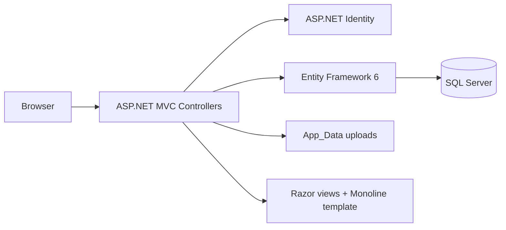
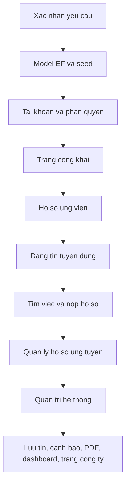
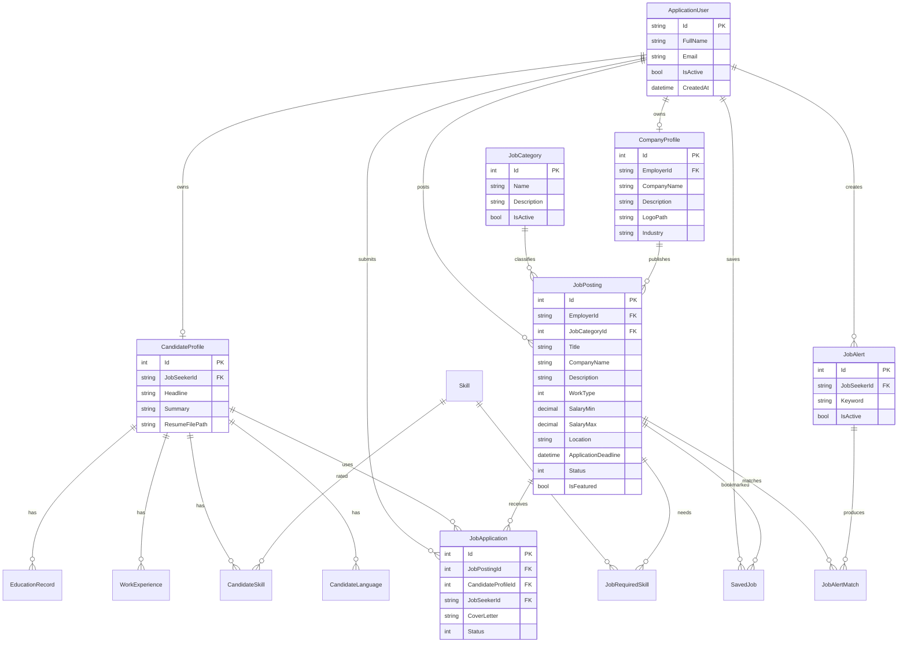

# Job Board and Recruitment Management System

Đồ án môn Phát triển ứng dụng web. Hệ thống kết nối người tìm việc với nhà tuyển dụng trên nền ASP.NET MVC, Entity Framework 6 và Microsoft SQL Server. Giao diện dùng template Monoline trong `JobBoardSystem/templates`. Dữ liệu hiển thị lấy từ cơ sở dữ liệu, không gắn sẵn trong view.

## 1. Xác nhận yêu cầu

### Công nghệ

| Hạng mục | Lựa chọn |
| --- | --- |
| Web | ASP.NET Web Application, MVC 5, C# |
| ORM | Entity Framework 6 Code First |
| Cơ sở dữ liệu | Microsoft SQL Server (LocalDB) |
| Xác thực | ASP.NET Identity, 3 vai trò |
| Giao diện | Template Monoline, Razor layout, nối Controller |

Không dùng Java. Không thêm nghiệp vụ ngoài đề bài.

### Yêu cầu cơ bản (8.0 điểm, có dữ liệu demo)

1. **User and Role Management (0.75).** Vai trò Job Seeker, Employer, Administrator. Đăng ký, đăng nhập, sửa thông tin cá nhân, đổi mật khẩu, phân quyền theo vai trò.
2. **Candidate Profile Management (1.25).** Hồ sơ ứng viên: thông tin cá nhân, học vấn, kinh nghiệm, kỹ năng, ngoại ngữ, tải resume.
3. **Job Posting Management (1.5).** Nhà tuyển dụng tạo, sửa, đóng, xóa tin. Mỗi tin có tiêu đề, tên công ty, ngành, mô tả, kỹ năng yêu cầu, hình thức làm việc, khoảng lương, địa điểm, hạn nộp.
4. **Job Search and Application (1.5).** Tìm và lọc theo ngành, địa điểm, khoảng lương, hình thức làm việc, từ khóa. Nộp hồ sơ kèm cover letter. Chặn nộp trùng, tin đã đóng và tin hết hạn.
5. **Application Management (1.0).** Nhà tuyển dụng xem ứng viên và cập nhật trạng thái: Submitted, Under Review, Shortlisted, Interview Scheduled, Offered, Rejected, Withdrawn.
6. **Administration (1.0).** Quản trị người dùng, ngành nghề, tin tuyển dụng và hồ sơ ứng tuyển.
7. **Homepage and Public Pages (1.0).** Trang chủ có việc nổi bật và duyệt theo ngành, trang danh sách việc, trang chi tiết việc, trang thông tin công ty.

### Yêu cầu nâng cao (2.0 điểm, có dữ liệu demo)

1. **Saved Jobs and Job Alerts (0.5).** Lưu tin và tạo cảnh báo theo từ khóa cho tin mới khớp.
2. **Resume and Profile Export (0.5).** Xuất hồ sơ ứng viên ra PDF.
3. **Dashboard and Statistics (0.75).** Thống kê tin đang mở, số lượng hồ sơ, ngành phổ biến, hoạt động nhà tuyển dụng.
4. **Employer Company Profile (0.25).** Trang công ty công khai: mô tả, logo, ngành, danh sách tin đang tuyển.

### Dữ liệu demo tối thiểu

- 1 Administrator, 5 Employer, 15 Job Seeker.
- 6 ngành nghề, 15 tin (Active, Closed, Expired).
- 20 hồ sơ ứng tuyển đủ các trạng thái xử lý.
- 10 hồ sơ ứng viên mức hoàn thiện khác nhau, mỗi hồ sơ tối thiểu 3 kỹ năng và 1 kinh nghiệm.
- Có tin có ứng viên và tin không có ứng viên.
- Có ứng viên đã nộp và ứng viên chưa nộp hồ sơ nào.
- Thêm company profile, saved jobs và job alerts cho phần nâng cao.

Tài khoản demo dùng chung mật khẩu `Pass@123` (đã băm trong SQL Server, không ghi mật khẩu vào view).

| Vai trò | Email |
| --- | --- |
| Administrator | admin@jobboard.local |
| Employer | employer1@jobboard.local … employer5@jobboard.local |
| Job Seeker | seeker01@jobboard.local … seeker15@jobboard.local |

## 2. Kiến trúc

Luồng xử lý: View chỉ bind dữ liệu Controller truyền xuống. Controller đọc và ghi qua `ApplicationDbContext`. Seed chạy một lần khi cơ sở dữ liệu được tạo.

## 3. Phân vai và lộ trình

| Giai đoạn | Phạm vi | Vai trò |
| --- | --- | --- |
| 1 | Đăng ký, đăng nhập, sửa hồ sơ tài khoản, đổi mật khẩu | Cả ba |
| 2 | Trang chủ, danh sách, chi tiết việc, trang công ty | Khách |
| 3 | Hồ sơ ứng viên, nộp đơn, rút đơn, lưu tin, cảnh báo, xuất PDF | Job Seeker |
| 4 | Hồ sơ công ty, đăng tin, đóng/xóa tin, duyệt đơn, dashboard | Employer |
| 5 | Người dùng, ngành, tin, đơn, thống kê toàn hệ thống | Administrator |

## 4. Use case

```mermaid
flowchart TB
    guest[Guest]
    seeker[Job Seeker]
    employer[Employer]
    admin[Administrator]

    guest --> UC1[Xem trang chu]
    guest --> UC2[Tim va loc viec]
    guest --> UC3[Xem chi tiet viec]
    guest --> UC4[Xem trang cong ty]
    guest --> UC5[Dang ky / Dang nhap]

    seeker --> UC6[Sua thong tin ca nhan va doi mat khau]
    seeker --> UC7[Quan ly ho so ung vien]
    seeker --> UC8[Tai resume va xuat PDF]
    seeker --> UC9[Nop don kem cover letter]
    seeker --> UC10[Rut don]
    seeker --> UC11[Luu tin]
    seeker --> UC12[Tao canh bao theo tu khoa]

    employer --> UC6
    employer --> UC13[Tao ho so cong ty]
    employer --> UC14[Tao sua dong xoa tin]
    employer --> UC15[Xem ung vien va doi trang thai]
    employer --> UC16[Xem dashboard nha tuyen dung]

    admin --> UC6
    admin --> UC17[Quan ly nguoi dung]
    admin --> UC18[Quan ly nganh nghe]
    admin --> UC19[Quan ly tin tuyen dung]
    admin --> UC20[Quan ly ho so ung tuyen]
    admin --> UC21[Xem thong ke he thong]
```

Ràng buộc nộp đơn:

- Chỉ Job Seeker đã có hồ sơ ứng viên mới nộp được.
- Không nộp lần thứ hai cho cùng một tin.
- Không nộp khi tin Closed, Expired, hoặc đã quá hạn nộp.

## 5. ERD

Trạng thái tin: Active, Closed, Expired. Trạng thái đơn: Submitted, Under Review, Shortlisted, Interview Scheduled, Offered, Rejected, Withdrawn.

Ràng buộc duy nhất: một hồ sơ ứng viên cho mỗi Job Seeker, một hồ sơ công ty cho mỗi Employer, một đơn cho mỗi cặp tin và ứng viên, một lượt lưu cho mỗi cặp ứng viên và tin.
